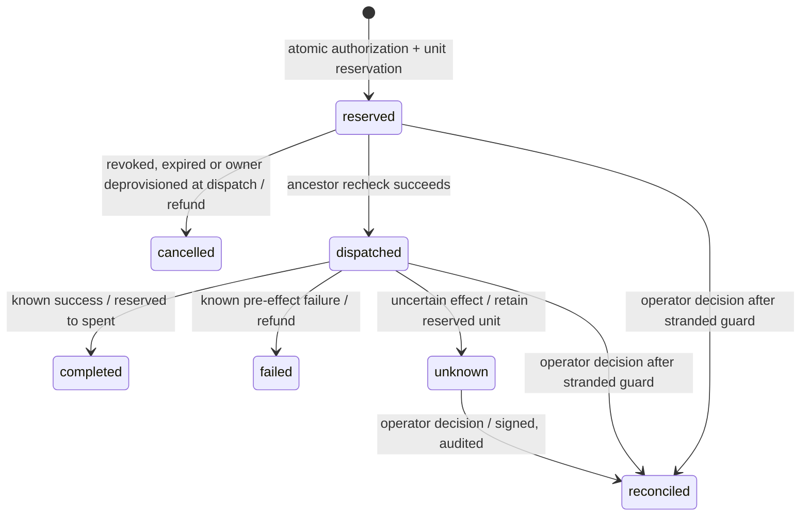

# Authorization semantics

## Grant model

A passport signs canonical JSON containing version, issuer public key, grant ID, root run ID, parent ID, subject label, exact resource/action pairs, expiry, and depth. The gateway verifies the signature and checks that the claims exactly match the durable record. Records are immutable except the separate revocation flag. A token from another issuer fails verification.

A subject is an operator-assigned name, not proof of an operating-system process identity. Root issuance is a trusted Python/control-plane action; it is not an agent API capability.

## Holder binding

A grant may carry a holder key: a raw Ed25519 public key stored with the grant and signed into the passport claims as `cnf`. Grants without one are bearer passports, as before; any process holding the token uses the same identity and budget.

For a key-bound passport, every agent request (operation, delegation, or passport read) must carry a proof in the `X-Passport-Proof` header. The proof is a signature by the holder's private key over canonical JSON containing:

```text
ath  SHA-256 of the exact passport token
op   execute | delegate | inspect
req  SHA-256 of the operation name and the exact request fields
iat  the holder's timestamp
jti  a single-use nonce
```

The gateway verifies the proof inside the same write transaction as the request. A missing proof is `PROOF_REQUIRED`. A wrong key, token, operation, or request is `PROOF_INVALID`. A timestamp more than 60 seconds from the gateway clock is `PROOF_STALE`. A nonce seen before for that grant is `PROOF_REPLAYED`. Nonces are kept for twice the freshness window, so pruning can never reopen a proof that would still be fresh. Each denial is recorded in the run's ledger.

Binding attenuates like scope. A child of a key-bound passport must name its own holder key (`BINDING_REQUIRED` otherwise), and the parent's proof covers that key, so an intercepted delegation cannot be redirected to another key. An unbound parent may issue a bound child. Receipts for bound operations include the holder key.

A fresh proof is required for each retry. The idempotency rules are unchanged: a retry with the same key and a new proof returns the recorded operation without executing again.

Existing databases are upgraded in place. Grants created before binding remain unbound, and their tokens verify unchanged.

The scripted story binds every agent, each to its own key. The MCP adapter generates its key in process memory at startup and writes only the public half to `.state/live-agent.pub`; the console binds the live passport to that key and refuses to issue one if the adapter has not registered. The adapter gives each worker it delegates a separate in-memory key.

Delegation requires a valid, unexpired, unrevoked ancestor chain. Each child pair must occur in its parent's pair set. Actions and resources are not separate allowlists: allowing `logs.read` on staging and `code.read` on a repository must never allow `logs.read` on the repository. No glob expansion, wildcard, or resource alias resolution exists. Expiry must be later than the server clock and no later than the parent. Depth is capped at eight, and a run at 150 grants.

## Budget invariant

For each root run:

```text
0 <= spent
0 <= reserved
spent + reserved <= budget
```

Every operation costs one integer unit; the client cannot set cost. All descendants refer to the same run row. Delegation creates no budget row and copies no allowance.

Reservation uses `BEGIN IMMEDIATE`. In that transaction the engine verifies the passport, walks ancestors, checks the exact pair, checks for an existing idempotency key, and executes:

```sql
UPDATE runs SET reserved = reserved + 1
WHERE id = ? AND spent + reserved < budget;
```

Zero affected rows means denial. The operation record and audit event commit with the reservation. A database check constraint independently prevents an invalid total. SQLite serializes local writers across threads and processes. This is a consistency mechanism, not a claim of horizontally distributed throughput. WAL readers can inspect a consistent snapshot without taking a writer lock.

## Operation lifecycle



The executor dispatches an operation only once. Only trusted executor code can settle it, and a settled operation cannot be settled again. The public agent API cannot refund, set prices, dispatch an arbitrary operation ID, or settle outcomes.

A retry with the same grant and idempotency key returns the recorded operation. Reusing that key for a different operation is denied. Retrying a completed operation after revocation is also denied: the chain check happens before returning a cached result. Different grants intentionally have independent key namespaces, but still compete for the same root pool.

If the process crashes after reservation or dispatch, the durable reservation remains. Retrying does not automatically run it again. This sacrifices availability to preserve the budget invariant. There is no automatic timed refund: a timeout does not prove that an upstream effect did not occur.

## Reconciliation

An operation in `unknown`, or stranded in `reserved` or `dispatched`, keeps its unit until a local operator decides what happened upstream. The operator runs `python scripts/reconcile.py` to list these operations, then records one decision per operation:

```text
completed      the effect happened; the reserved unit becomes spent
not_executed   no effect happened; the reserved unit returns to the shared pool
```

Each decision requires a written basis of 10 to 500 characters and names the deciding operator. In one write transaction, the engine checks the operation is still unresolved, updates its state with a guarded write, moves the unit, appends a `reconciled` ledger event, and stores a reconciliation receipt signed by the issuer. A second decision, or a decision about a settled operation, is denied with `OPERATION_STATE`.

The decision is final for that operation and its idempotency key. A retry with the same key returns the reconciled record and never executes. A late executor cannot dispatch a reconciled reservation or settle a reconciled dispatch.

A `reserved` or `dispatched` operation may still be running in an executor. It cannot be reconciled until 300 seconds after its reservation (`OPERATION_IN_FLIGHT`). This guard only delays the operator's decision; nothing is ever settled by elapsed time. `unknown` operations have already left the executor and have no guard.

Reconciliation is an operator surface: the console session endpoints and the local script. The agent API has no equivalent. The receipt attests that the issuer recorded the operator's statement, not that the upstream effect did or did not occur. A wrong `not_executed` decision returns a unit that was actually spent.

### From the upstream's effect record

The fixture service keeps its own effect log, standing in for an upstream with idempotency keys and a queryable effect record. The executor sends the operation ID as the idempotency key. The upstream produces the effect and records it under that ID in one transaction, and a repeated ID returns the recorded result without applying anything.

Instead of stating an outcome, the operator can ask the upstream with `python scripts/reconcile.py OPERATION_ID --lookup` or `POST /api/operations/{oid}/lookup` from the console session. The lookup follows the same rules as an operator decision: it applies only to an unresolved operation past the in-flight guard, once, with a signed receipt.

```text
record found      reconciled completed; the receipt's basis includes the recorded result digest
no record         the upstream fences the ID first, then reconciled not_executed
other operation   EFFECT_MISMATCH; nothing changes, decide by hand
lookup fails      LOOKUP_FAILED or LOOKUP_UNSUPPORTED; nothing changes, no fence
```

Fencing is what makes a refund sound. "Not found" alone could be a request still in transit. Once fenced, a late delivery of that ID is refused before any effect, so the returned unit can never be spent upstream too.

The lookup is only as good as the upstream's guarantee that effects and records are atomic. The receipt attests what the upstream reported, not independent proof of the effect. A real adapter needs an upstream that offers both idempotency keys and fencing, or an equivalent cancel-if-not-started call.

## Revocation linearization

Revocation commits a flag on a grant in a write transaction. Reservations and dispatches inspect every ancestor in their own write transaction. A dispatch transaction committed after revocation observes it and fails. A dispatch committed before revocation can proceed and finish afterward. The final service call is outside the DB transaction; revocation is not a cancellation primitive for work that has already crossed the dispatch boundary.

Reservations cancelled before dispatch return their units once. Descendant rows are not rewritten on revocation; effective status is derived from the ancestor chain. Sibling branches remain valid, although an abusive branch may already have consumed the shared budget. Containment does not guarantee fairness or unspent capacity for siblings.

There is no authorization cache. A database error fails the request rather than falling back to allow.

## Accountable owners and deprovisioning

Every root is issued on behalf of an owner: an operator-managed record of a human with an ID, user name, display name, optional external ID, an active flag, an epoch, and timestamps. `create_run(owner=...)` names one. Callers that name none get the default `Local operator` owner, created on first use. The scripted console run uses that default owner.

The owner ID is signed into the root's claims as `owner`, and every descendant inherits it unchanged. Operation and reconciliation receipts include it. Grants created before owners existed are upgraded in place without one: their tokens verify unchanged, they carry no `owner` claim, and no owner check applies to them.

Deprovisioning is an online fact, like revocation. `_chain` reads the root's owner row in the same write transaction as each reservation and dispatch. The check fails with `OWNER_DEPROVISIONED` when the owner is inactive, or when the root was issued under an earlier owner epoch. No descendant row is rewritten; status is derived. Consequences follow the revocation rules:

```text
reserved, not dispatched   cancelled at dispatch, unit returned once
dispatched                 keeps its unit; the trusted executor may still settle it
unknown                    keeps its unit until an operator reconciles it
new reservation/delegation denied, OWNER_DEPROVISIONED
new root for the owner     denied while the owner is inactive
```

Deactivation commits under the same SQLite write lock as reservations, so no reservation committed after it can succeed for that owner's grants.

Reactivation does not restore old grants. Each deactivation increments the owner's epoch, and a root records the epoch it was issued under. After reactivation the owner can be issued new roots; every grant issued before the deactivation stays void, even if no time has passed. Restoring access means new issuance. Resetting the console re-provisions the default owner if it was deactivated, with its own signed receipt, and issues a new run; it never reactivates any other owner.

Each change (provisioned, deprovisioned, reactivated) is signed by the issuer as a `lifecycle` receipt naming the owner, the change, the resulting active flag and epoch, the acting operator, and the runs issued for that owner at that moment. Owner changes are not per run, so they are recorded twice: the signed receipt goes into an owner-level `lifecycle` table, and a hash-linked `deprovisioned` or `reactivated` event is appended to the ledger of every affected run in the same transaction. A run's evidence export includes the full signed lifecycle of its owner under `lifecycle`. The verifier checks each signature, requires `type: lifecycle`, and requires the receipt to name the run's owner. Operation receipts must carry no `type`, and reconciliations, checkpoints and lifecycle receipts each require their own, so none can stand in for another. A lifecycle receipt attests the operator's statement of a provisioning change, not the person's identity.

Owners are managed only from operator surfaces: `python scripts/owners.py`, the console's owners panel (deactivate only), and a SCIM-shaped subset under `/scim/v2/Users`:

```text
POST   /scim/v2/Users           provision (userName, displayName, optional externalId; created active)
GET    /scim/v2/Users           list; the only supported filter is userName eq "..."
GET    /scim/v2/Users/{id}      read
PATCH  /scim/v2/Users/{id}      exactly one replace of active: {"path":"active","value":false} or {"value":{"active":false}}
DELETE /scim/v2/Users/{id}      deprovision; the record is kept so past authority stays attributable
```

This is a demo subset in SCIM's shape, not a conformant SCIM server: no other attributes, filters, paging, PUT, bulk, ETags, `/Schemas` or `/ServiceProviderConfig`; validation errors return 422 rather than SCIM's 400; DELETE leaves the user readable. Request bodies are strict and reject unknown fields. Authentication is the local console session header. Any request carrying an `Authorization` header is refused, so neither a SCIM bearer token nor an agent passport can reach it. There is no identity-provider integration. This implementation does not model remote authorization servers, partitions, distributed clocks, or bounded offline access.

## Credential boundary

The allowed operation catalog maps fixed resource/action pairs to a synthetic service. The provider is configured by the server operator, never by an agent. The 1Password provider calls an absolute `op` executable discovered from the operator's PATH with a fixed argument vector and no shell. It captures the secret in process memory and never forwards CLI stderr, stdout, or exception output to the agent. A synthetic service checks the configured key's SHA-256 digest and returns known fixture data.

This validates credential separation and retrieval, not a production service integration. Python strings cannot be reliably zeroized. The host OS, PATH, CLI, issuer key, database, and trusted executor process are all inside the trust boundary.

## Evidence

Each event includes the hash of the previous event in its run. Receipts sign the operation ID, grant, ancestor IDs, request digest, resource/action, outcome, result digest, cost, policy version, and time using Ed25519. The offline verifier requires a caller-supplied pinned public key. Event and receipt exports use a consistent read transaction.

Hash linking detects accidental modification and reordering but, without external anchoring, does not stop the database owner rewriting the chain or removing a suffix. Signatures resist receipt alteration without the issuer key; they do not make the issuer honest or prove an external effect.

## Checkpoints

A checkpoint is an issuer-signed statement of a run's event count and the hash of its last event at that moment:

```text
{"type": "checkpoint", "run_id": ..., "size": 14, "head": "<hash of event 14>", "policy": ..., "time": ...}
```

The operator signs one with `python scripts/checkpoint.py`, or `POST /api/checkpoint` from the console session, and appends it to a witness file. The witness file is the anchor, so it has to live where the database owner cannot rewrite it: another machine, a colleague's inbox, a printout of the head hash. The default `artifacts/witness.jsonl` is beside the state directory for convenience and protects nothing until it is copied elsewhere.

Given the pinned issuer key and witnessed checkpoints, `verify_evidence.py --checkpoints` requires that each checkpoint is signed by that key, belongs to the run, and that the exported chain's hash at position `size` equals `head`. This detects:

- a removed suffix, because the export has fewer events than a checkpoint covers;
- a chain rewritten and fully recomputed by someone without the issuer key, because the head at the checkpointed position changes;
- a checkpoint from another issuer or another run.

Before appending, the checkpoint script verifies the current log against every checkpoint the witness file already holds for that run. A rolled-back or rewritten history is refused, and the witness file is left unchanged.

A checkpoint covers only the events before it. Anything appended afterwards is reported as unanchored and can still be rewritten until the next checkpoint. The issuer key holder can sign a checkpoint of any history, so a checkpoint shows what the issuer's log contained when it was witnessed, not that the log is truthful or complete with respect to what agents actually did. The chain is linear, so checking a checkpoint needs the full prefix; there are no Merkle inclusion proofs.
