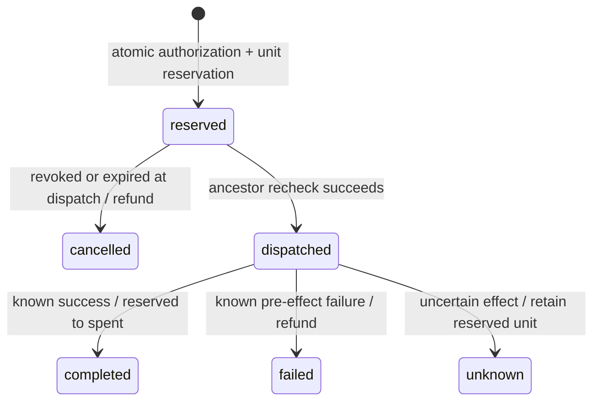

# Authorization semantics

## Grant model

A passport signs canonical JSON containing version, issuer public key, grant ID, root run ID, parent ID, subject label, exact resource/action pairs, expiry, and depth. The gateway verifies the signature and checks that the claims exactly match the durable record. Records are immutable except the separate revocation flag. A token from another issuer fails verification.

A subject is an operator-assigned name, not proof of an operating-system process identity. The passport is a bearer credential. Two processes holding the same passport use the same identity and budget. Root issuance is a trusted Python/control-plane action; it is not an agent API capability.

Delegation requires a valid, unexpired, unrevoked ancestor chain. Each child pair must occur in its parent's pair set. Actions and resources are not separate allowlists: allowing `logs.read` on staging and `code.read` on a repository must never allow `logs.read` on the repository. No glob expansion, wildcard, or resource alias resolution exists. Expiry must be later than the server clock and no later than the parent. Depth is capped at eight, and a run at 150 grants.

## Budget invariant

For each root run:

```text
0 <= spent
0 <= reserved
spent + reserved <= budget
```

Every operation costs one integer unit; the client cannot set cost. All descendants refer to the same run row. Delegation creates no budget row and copies no allowance.

Reservation uses `BEGIN IMMEDIATE`. In that transaction the engine verifies the passport, walks ancestors, checks the exact pair, checks for an existing idempotency key, and executes:

```sql
UPDATE runs SET reserved = reserved + 1
WHERE id = ? AND spent + reserved < budget;
```

Zero affected rows means denial. The operation record and audit event commit with the reservation. A database check constraint independently prevents an invalid total. SQLite serializes local writers across threads and processes. This is a consistency mechanism, not a claim of horizontally distributed throughput. WAL readers can inspect a consistent snapshot without taking a writer lock.

## Operation lifecycle



The executor dispatches an operation only once. Only trusted executor code can settle it, and a settled operation cannot be settled again. The public agent API cannot refund, set prices, dispatch an arbitrary operation ID, or settle outcomes.

A retry with the same grant and idempotency key returns the recorded operation. Reusing that key for a different operation is denied. Retrying a completed operation after revocation is also denied: the chain check happens before returning a cached result. Different grants intentionally have independent key namespaces, but still compete for the same root pool.

If the process crashes after reservation or dispatch, the durable reservation remains. Retrying does not automatically run it again. This sacrifices availability to preserve the budget invariant. There is no automatic timed refund: a timeout does not prove that an upstream effect did not occur. Future adapters need an explicit reconciliation protocol or upstream idempotency support.

## Revocation linearization

Revocation commits a flag on a grant in a write transaction. Reservations and dispatches inspect every ancestor in their own write transaction. A dispatch transaction committed after revocation observes it and fails. A dispatch committed before revocation can proceed and finish afterward. The final service call is outside the DB transaction; revocation is not a cancellation primitive for work that has already crossed the dispatch boundary.

Reservations cancelled before dispatch return their units once. Descendant rows are not rewritten on revocation; effective status is derived from the ancestor chain. Sibling branches remain valid, although an abusive branch may already have consumed the shared budget. Containment does not guarantee fairness or unspent capacity for siblings.

There is no authorization cache. A database error fails the request rather than falling back to allow. This implementation does not model remote authorization servers, partitions, distributed clocks, or bounded offline access.

## Credential boundary

The allowed operation catalog maps fixed resource/action pairs to a synthetic service. The provider is configured by the server operator, never by an agent. The 1Password provider calls an absolute `op` executable discovered from the operator's PATH with a fixed argument vector and no shell. It captures the secret in process memory and never forwards CLI stderr, stdout, or exception output to the agent. A synthetic service checks the configured key's SHA-256 digest and returns known fixture data.

This validates credential separation and retrieval, not a production service integration. Python strings cannot be reliably zeroized. The host OS, PATH, CLI, issuer key, database, and trusted executor process are all inside the trust boundary.

## Evidence

Each event includes the hash of the previous event in its run. Receipts sign the operation ID, grant, ancestor IDs, request digest, resource/action, outcome, result digest, cost, policy version, and time using Ed25519. The offline verifier requires a caller-supplied pinned public key. Event and receipt exports use a consistent read transaction.

Hash linking detects accidental modification and reordering but, without external anchoring, does not stop the database owner rewriting the chain or removing a suffix. Signatures resist receipt alteration without the issuer key; they do not make the issuer honest or prove an external effect.
